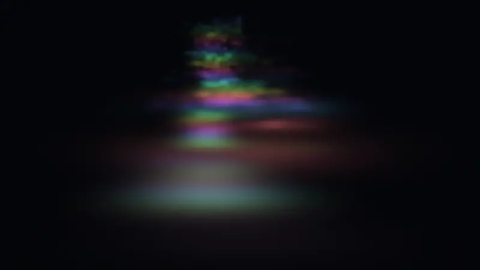
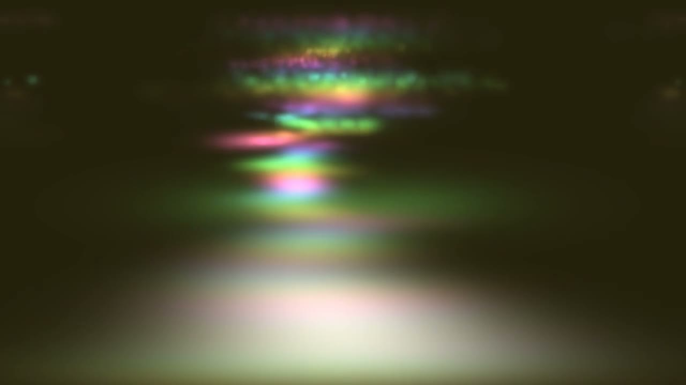

<p align="center">
  
</p>

<h1 align="center">mviz</h1>

<p align="center">
  A looping music player that shows the <b>stereo sound field</b>:<br>
  every frequency of the music as light, placed where you hear it.
</p>

<p align="center">
  
</p>


## What you see

You are sitting in front of the speakers:

- **Left ↔ right** is where a sound sits between the speakers. Sound that is out
  of phase between the channels (stereo wideners, some reverbs) appears
  **beyond the speakers**, towards the window edges, which is where you hear it.
- **Bottom ↔ top** is pitch, on a musical (logarithmic) scale: every octave gets
  the same height.
- **Colour** is the note: every C has the same hue, every C♯ the next one, and
  so on. Every colour emits the same amount of light, so brightness shows
  loudness, not the note. Sounds without a pitch (cymbals, hi-hats, breath,
  noise) are white and dimmer, so they don't wash out the notes around them.
- **Brightness** follows perceived loudness: what the ear hears (the ISO 226
  equal-loudness curves) plus deep bass felt in the body.
- **Size and softness** grow with depth. The deepest bass spreads into a wide,
  flat **carpet** along the bottom, and the highs are small, round sparks.
- **Direct sounds are crisp; diffuse ones (reverb, wide pads) are larger and
  softer.** Every frequency bin is placed on its own, so instruments that share
  a range still appear side by side.
- **Afterglow:** light fades like a phosphor screen: fast at first, then slowly.
  Moving sounds leave trails, and overlapping light adds up like light.
- **Background:** the bass (below about 80 Hz) lights the background, each side
  with its own channel, tinted by the bass note (paler when the bass has no
  clear pitch). It shares the field's loudness scale, so a bass-heavy mix
  lights it more than a thin one. Colour changes crossfade, and the glow
  fades out like the rest. Live input measures this as it arrives, so its colour follows
  the bass a moment behind.

The light is computed live from the audio: each frame analyses the music at the
playback position with FFTs at three resolutions (long windows for the bass,
short ones for the treble), crossfaded between, and places each frequency bin
by its left/right level, polarity and, at low frequencies, arrival time.

<p align="center">
  
</p>

## Using it

```sh
mviz song.mp3        # one song, looped
mviz ~/Music/Album   # a folder: every song in order, then from the start
mviz                 # the start screen
```

Without a file, mviz opens a start screen: open a file or a folder, reopen the
last one, or **capture** an output (whatever it plays) or an input such as a microphone and
watch it live. Resting on a source shows its input level. Behind it, slow
fields of colour drift and blend under a heavy blur. Tab brings the same
screen up over the picture, blurring and darkening it.

The song starts at once (about 40 ms after launch) and loops without a gap.

| Input | Action |
| --- | --- |
| Right-click or Space | Pause / resume |
| Scroll | Volume (remembered between runs) |
| Left-drag | Move the window (from fullscreen: back to a window, then move) |
| Double-click or F11 | Fullscreen on / off |
| Timeline at the bottom | Shown while the cursor is visible; click or drag to seek |
| Drop a file or folder on the window | Play it instead |
| Right edge (folder) | The playlist; click a song to play it (L keeps it open) |
| S, or the order in the playlist | Play the folder by name, newest first, or shuffled |
| ← / → | Previous / next song of the folder |
| Tab | Start screen over the picture |
| Ctrl+O / Ctrl+Shift+O | Open a file / a folder |
| Esc | Quit |

mviz also appears in the desktop's **media controls** (MPRIS): the Plasma media
widget, the lock screen, media keys, Bluetooth headphone buttons and KDE Connect
can play, pause, seek and change the volume. It shows the title, artist, album
and cover from the file's tags.

Supported formats: MP3, FLAC, Ogg Vorbis, WAV, AIFF, CAF, and AAC / ALAC in M4A
or MP4.

### Exporting a video

```sh
mviz --render song.mp3 clip.mp4 --start 88 --seconds 12 --size 1280x720
```

This renders the visualizer offscreen (same GPU pipeline as the window) at
exactly 60 frames per second of song time and lets `ffmpeg` add the matching
audio. The preview above was made this way.

## Building and installing

Linux only. You need:

- a recent stable **Rust** (tested with 1.94)
- **ALSA** development files (`alsa-devel` / `libasound2-dev`) and `pkg-config`.
  PipeWire and PulseAudio work through their ALSA plugins.
- a GPU with **Vulkan** or OpenGL ES support (rendering uses wgpu)
- `ffmpeg`, only for `--render`

```sh
cargo build --release

# install for your user
install -Dm755 target/release/mviz ~/.local/bin/mviz
install -Dm644 assets/mviz.svg ~/.local/share/icons/hicolor/scalable/apps/mviz.svg
install -Dm644 assets/mviz.desktop ~/.local/share/applications/mviz.desktop

# optional: make it the default player for common audio files
for t in audio/mpeg audio/flac audio/ogg audio/x-vorbis+ogg audio/x-wav audio/mp4 audio/aac; do
  xdg-mime default mviz.desktop "$t"
done
```

All visual settings (sizes, colours, fade time, stereo width, …) live in one
place, [`src/params.rs`](src/params.rs), each with a short description.

## License

mviz is released under the [MIT License](LICENSE). It includes the
[Noto Sans](https://notofonts.github.io/) font, which is under the
[SIL Open Font License 1.1](assets/NotoSans-LICENSE.txt).
